

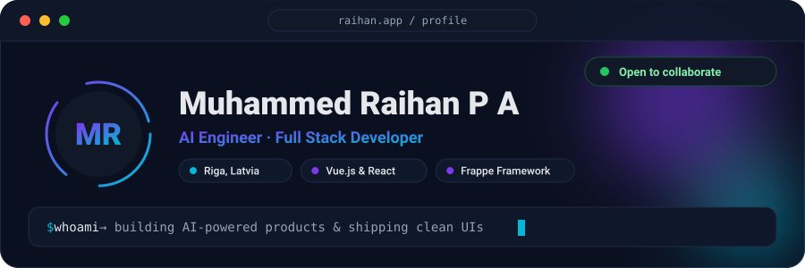

  

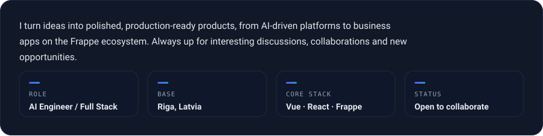

  

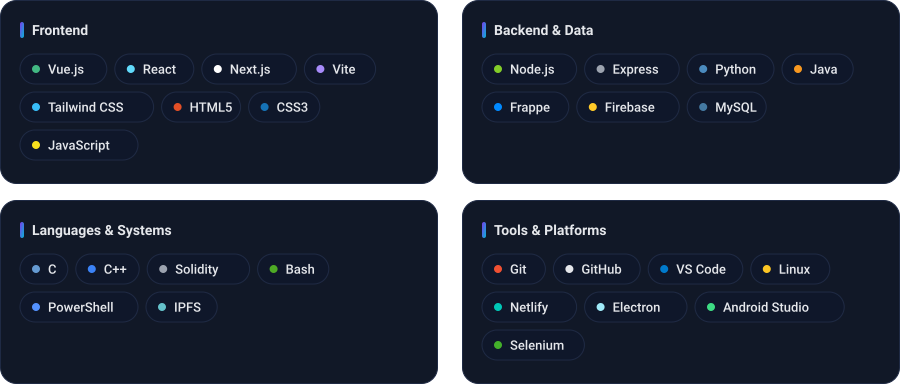

  

<a href="https://altadhamanmedicalcenter.com">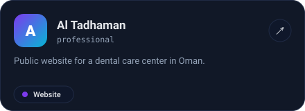</a>
<a href="https://wahatalromman.com">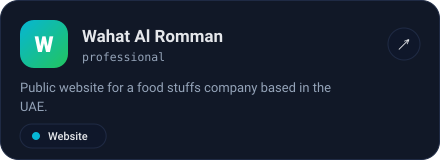</a>
<a href="https://github.com/tridz-dev/quick_kanban">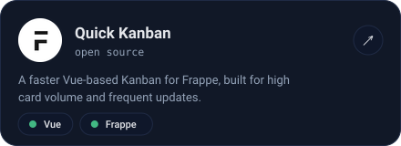</a>
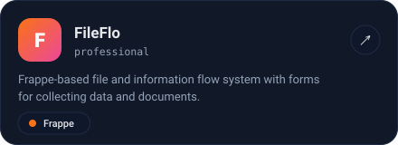

  

<a href="https://github.com/pu-raihan/InternGenie">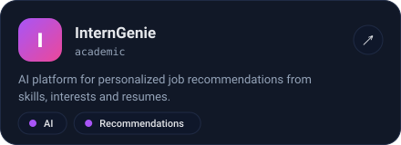</a>
<a href="https://github.com/pu-raihan/CamBuzz">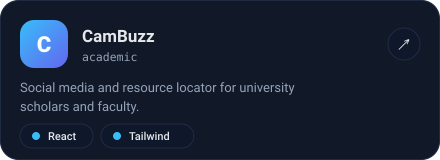</a>
<a href="https://github.com/pu-raihan/ProjectChain">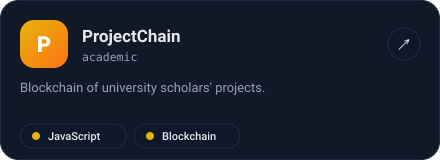</a>
<a href="https://github.com/pu-raihan/FindYourDorm">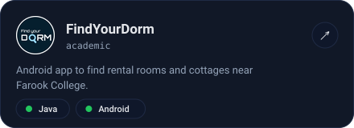</a>

  

 

  

